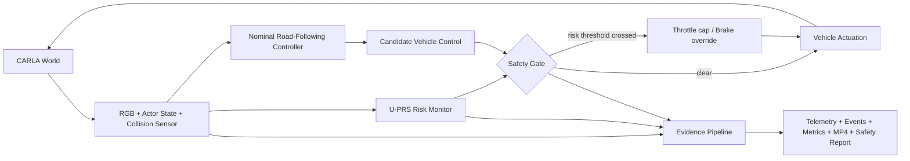

# HALOShield-CARLA

**Uncertainty-Aware Predictive Runtime Safety Shielding for Randomized Closed-Loop CARLA Driving**

HALOShield-CARLA is a research-grade, laptop-constrained autonomous-driving safety prototype. It runs a randomized ~120-second closed-loop CARLA scenario, compares a nominal waypoint-following controller with an independent predictive safety shield, records the experiment to MP4, and saves traceable safety evidence.

## Research question

**Can a lightweight, uncertainty-inflated short-horizon runtime safety shield reduce collision exposure and critical time-to-collision events in randomized CARLA interactions while preserving useful driving progress on commodity 8 GB GPU hardware?**

## Key contribution

The proposed **U-PRS (Uncertainty-aware Predictive Runtime Shield)** separates nominal autonomy from safety assurance. At every control cycle it projects nearby actors over multiple short horizons with constant-velocity dynamics, inflates their safety envelope as prediction uncertainty grows, computes time-to-collision and predicted clearance, and independently limits throttle or overrides braking. The same scenario seed can run in `baseline` mode (monitor only) or `shield` mode (monitor + intervention), enabling paired causal comparison.

This is intentionally not a giant deep-learning project. The research contribution is the safety architecture, traceability, uncertainty treatment, randomized hazard evaluation, paired experiment design, and failure evidence.

## NVIDIA Halos integration boundary

NVIDIA publicly describes Halos as a full-stack autonomous-vehicle safety system, with **Halos OS** providing system-software safeguards and **Halos SAFE** providing simulation/evaluation workflows that turn requirements into repeatable scenarios, KPIs, tests, and traceable evidence.

HALOShield-CARLA **does not run NVIDIA Halos OS, Halos Core, DRIVE OS, or any proprietary NVIDIA safety runtime**. Those technologies are not represented as installed on this laptop. This repository implements an original, research-only compatibility architecture inspired by publicly documented Halos safety principles:

| Layer | This project |
|---|---|
| Simulation | CARLA 0.9.16 |
| Nominal autonomy | Readable waypoint + PID-style controller |
| Independent safety mechanism | U-PRS predictive runtime shield |
| Evaluation/evidence | Seeded scenarios, telemetry, events, metrics, video, safety report |
| Genuine NVIDIA Halos OS/Core | **Not included / not claimed** |
| Certification | **None** |

Official public reference: https://www.nvidia.com/en-us/ai-trust-center/halos/autonomous-vehicles/

## Why CARLA 0.9.16

This project pins **CARLA 0.9.16 (UE4 line)**. CARLA's 0.9.16 quick-start documentation recommends an NVIDIA 2070-class GPU or better with **at least 8 GB VRAM**, about **20 GB disk**, and supports Python 3.7-3.12. The newer UE5 CARLA line recommends materially more GPU memory, so it is not the default for this 8 GB RTX 5060 laptop.

Official reference: https://carla.readthedocs.io/en/0.9.16/start_quickstart/

The installer does **not** download AdditionalMaps, does **not** build Unreal Engine, and streams the CARLA archive directly into extraction so the ~8 GB compressed archive is not retained beside the ~20 GB installation.

## Target machine

Default resource decisions target:

- NVIDIA RTX 5060 Laptop GPU, 8 GB VRAM
- Intel Core i7-13620H, 10 cores / 16 threads
- 16 GB RAM
- Ubuntu 24.04.4 LTS
- NVIDIA driver 580.126.20
- CUDA-capable driver; CUDA toolkit reinstallation is not required
- ~32 GB free storage before first install

The project uses a 960×540, 10 FPS research camera, conservative traffic counts, UE4 `Low` quality, offscreen CARLA rendering plus a lightweight dashboard, no neural model training, and bounded logging.

## One-command use

```bash
chmod +x run_project.sh
./run_project.sh
```

First run:

1. validates minimal system tools;
2. creates `.venv` with Python 3.10-3.12;
3. installs pinned Python dependencies;
4. reuses CARLA 0.9.16 if found;
5. otherwise checks disk space and installs the packaged binary;
6. installs the matching CARLA Python API;
7. starts CARLA automatically;
8. runs the randomized 120-second experiment;
9. records `demo.mp4`;
10. saves telemetry, scenario, metrics, events, system info, logs, and a safety report;
11. destroys actors/sensors and stops the CARLA process it created.

Subsequent runs reuse `.venv` and the cached CARLA installation.

## Useful commands

```bash
# Diagnostics only; does not force a CARLA download
./run_project.sh --doctor

# Deterministic run
./run_project.sh --seed 194827361

# Exact replay of a saved scenario
./run_project.sh --replay outputs/<run>/scenario.json

# Baseline: calculate risk but do not apply safety overrides
./run_project.sh --mode baseline --seed 194827361

# Proposed safety shield
./run_project.sh --mode shield --seed 194827361

# No live dashboard; still records video
./run_project.sh --headless

# Short engineering smoke run
./run_project.sh --duration 20 --scenario-density low

# Paired experiment suite (baseline + shield for each seed)
./run_benchmark.sh --runs 10 --duration 60
```

## Runtime architecture



## Scenario design

A normal run varies, from the stored random seed:

- map (prefers smaller built-in towns);
- ego/lead spawn location;
- background traffic placement;
- pedestrian placement;
- weather;
- traffic counts;
- lead-vehicle separation;
- two hard-braking hazard trigger times;
- hazard duration and braking intensity.

The ego and scripted lead both use readable lane-following control so the hazard remains physically meaningful. The lead performs two seeded hard-braking events during the two-minute run. Background Traffic Manager vehicles and pedestrians create additional interaction diversity.

## Outputs

Each run creates a directory such as:

```text
outputs/2026-10-27_15-42-17_seed-194827361_shield/
├── demo.mp4
├── summary.json
├── metrics.csv
├── events.jsonl
├── telemetry.csv
├── scenario.json
├── config_snapshot.yaml
├── system_info.json
├── run.log
├── carla_server.log
└── safety_report.md
```

`scenario.json` is the replay contract. `telemetry.csv` is per-tick evidence. `summary.json` and `metrics.csv` are run-level results. `events.jsonl` contains hazards, collisions, and notable failures. `demo.mp4` is encoded directly from the camera stream; raw frame sequences are not retained.

## Metrics

The implementation records:

- collisions;
- minimum time-to-collision;
- minimum predicted clearance;
- intervention ticks and intervention events;
- near-miss ticks (`TTC < 1.5 s`);
- distance traveled;
- mean vehicle speed;
- safety-layer latency;
- applied/nominal throttle and braking;
- threat actor ID and risk state.

## Project tree

```text
haloshield-carla/
├── run_project.sh
├── run_benchmark.sh
├── config/default.yaml
├── scripts/
│   ├── bootstrap.sh
│   └── install_carla.sh
├── src/haloshield/
│   ├── autonomy.py
│   ├── benchmark.py
│   ├── carla_bridge.py
│   ├── cli.py
│   ├── config.py
│   ├── dashboard.py
│   ├── experiment.py
│   ├── logging_utils.py
│   ├── metrics.py
│   ├── recorder.py
│   ├── reporting.py
│   ├── safety.py
│   ├── scenario.py
│   ├── system.py
│   ├── types.py
│   └── utils.py
├── tests/
└── docs/
```

## Research integrity and safety scope

This project is simulation research software. It is **not** NVIDIA-certified, Halos-certified, ASIL-certified, a production AV stack, or evidence that a real vehicle is safe. Do not deploy it on public roads or real vehicles. Benchmark results must be measured before any claim about improvement is made.

See `docs/research.md`, `docs/architecture.md`, `docs/experiment.md`, `docs/halos_mapping.md`, `docs/reproducibility.md`, and `docs/troubleshooting.md`.
