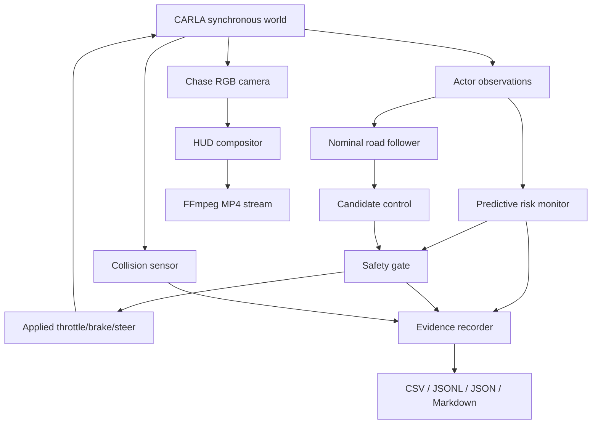

# Architecture

## Data flow

## Module contracts

### `autonomy.py`
**Input:** CARLA ego state, road map, target speed.
**Process:** persistent waypoint lookahead + steering feedback + speed PID.
**Output:** nominal throttle, brake, steer.
**Why:** supplies a transparent controller whose action can be independently safety-checked.

### `safety.py`
**Input:** pure Python `EgoState` and `ActorState` records.
**Process:** corridor filtering, TTC, multi-horizon projection, uncertainty inflation, risk classification, hysteresis.
**Output:** `SafetyDecision`, then optionally a constrained control.
**Why:** isolates the proposed research contribution from CARLA-specific APIs and makes it unit-testable.

### `scenario.py`
**Input:** seed, experiment configuration, CARLA map list.
**Process:** seeded selection of map/weather/traffic/hazard parameters.
**Output:** serializable `ScenarioSpec`.
**Why:** supports stochastic normal operation and exact replay.

### `experiment.py`
**Input:** configuration, scenario, mode.
**Process:** simulator lifecycle, actor/sensor creation, closed-loop control, evidence collection, cleanup.
**Output:** run directory.
**Why:** makes the experiment executable end to end.

### `recorder.py` / `dashboard.py`
**Input:** camera frames + current safety telemetry.
**Process:** human-readable overlay + direct ffmpeg streaming.
**Output:** MP4 without retaining raw frame sequences.
**Why:** visual evidence under strict storage constraints.
